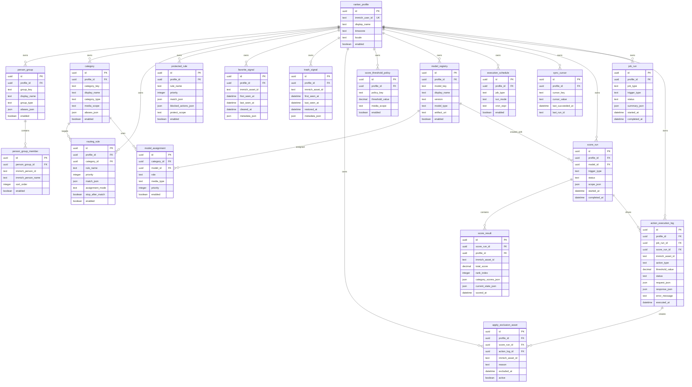

# Smart Ranker DBスキーマ案

## 目的

- GUI から変更しうる設定を DB に集約する。
- v2 は `learn` の手動 signal、`score` の全件 snapshot、`apply` の auto trash 除外台帳を保持できる論理スキーマを定義する。
- 物理 DB は SQLite または Postgres のどちらでも載せ替え可能とする。

## 対象範囲

| 項目 | 主テーブル |
| --- | --- |
| 対象人物グループ | `person_group`, `person_group_member` |
| カテゴリ定義 | `category` |
| カテゴリへの振り分け条件 | `routing_rule` |
| 保護対象ルール | `protected_rule` |
| favorite の手動 signal | `favorite_signal` |
| trash の手動 signal | `trash_signal` |
| auto trash 除外台帳 | `apply_exclusion_asset` |
| score 閾値 | `score_threshold_policy` |
| score snapshot | `score_run`, `score_result` |
| モデル割当 | `model_registry`, `model_assignment` |
| 実行スケジュール | `execution_schedule` |
| job 実行履歴 | `job_run` |
| apply 実行ログ | `action_execution_log` |
| 同期カーソル | `sync_cursor` |

## 設計方針

- 設定のスコープ単位は `ranker_profile` とする。
- Immich 側の Person は Smart Ranker 側では参照 ID として保持する。
- favorite と trash は別テーブルで保持し、解除や restore の後も行を残す。
- `apply` が trash へ移した asset は `apply_exclusion_asset` に登録し、`learn` の再収集対象から外す。
- score は run 単位で保存し、GUI は最新 completed `score_run` を表示基準にする。
- 条件式は `match_json`、可変設定は `config_json`、一覧表示補助は `display_json` に寄せる。
- `JSON` 型は SQLite では `TEXT + JSON バリデーション`、Postgres では `JSONB` を想定する。

## ER図



## テーブル定義

### プロファイルと表示名

| テーブル | 役割 | 主カラム |
| --- | --- | --- |
| `ranker_profile` | 設定の所有者。Immich ユーザー単位の設定スコープ。 | `immich_user_id`, `display_name`, `timezone`, `locale`, `enabled` |
| `person_group` | 「家族」「我が子」などの人物グループ定義。GUI 表示名と別名も保持。 | `group_key`, `display_name`, `group_type`, `aliases_json`, `enabled` |
| `person_group_member` | 人物グループと Immich Person の対応。 | `person_group_id`, `immich_person_id`, `immich_person_name`, `sort_order`, `enabled` |
| `category` | 基本ラベル、特別ラベル、派生ラベルの定義。 | `category_key`, `display_name`, `category_type`, `media_scope`, `aliases_json`, `enabled` |

### ルーティングと保護

| テーブル | 役割 | 主カラム |
| --- | --- | --- |
| `routing_rule` | asset へカテゴリを追加付与する条件。 | `category_id`, `rule_name`, `priority`, `match_json`, `assignment_mode`, `stop_after_match`, `enabled` |
| `protected_rule` | auto trash から除外する条件。 | `rule_name`, `priority`, `match_json`, `blocked_actions_json`, `protect_scope`, `enabled` |

### 学習 signal の保持

| テーブル | 役割 | 主カラム |
| --- | --- | --- |
| `favorite_signal` | current favorite と過去 favorite の手動 signal を保持する。解除後も消さない。 | `immich_asset_id`, `first_seen_at`, `last_seen_at`, `cleared_at`, `metadata_json` |
| `trash_signal` | current trash と過去 manual trash の手動 signal を保持する。restore 後も消さない。 | `immich_asset_id`, `first_seen_at`, `last_seen_at`, `restored_at`, `metadata_json` |
| `apply_exclusion_asset` | `apply` で trash へ移した asset を future `learn` から除外する。 | `immich_asset_id`, `score_run_id`, `action_log_id`, `reason`, `excluded_at`, `active` |
| `sync_cursor` | favorite / trash 同期や API pagination の水位を保持する。 | `cursor_key`, `cursor_value`, `last_succeeded_at`, `last_run_id` |

### モデルと score 制御

| テーブル | 役割 | 主カラム |
| --- | --- | --- |
| `model_registry` | 利用可能なモデルの台帳。モデルの種類、版、格納先を保持。 | `model_key`, `display_name`, `version`, `model_type`, `artifact_uri`, `enabled` |
| `model_assignment` | カテゴリに対するモデル割当。汎用モデルと専用モデルの両方を扱う。 | `category_id`, `model_id`, `role`, `media_type`, `priority`, `enabled` |
| `score_threshold_policy` | GUI が操作する削除閾値。まずは profile 単位 1 本を想定する。 | `policy_key`, `threshold_value`, `media_scope`, `enabled` |
| `score_run` | 1 回の全件 score のヘッダ。どのモデルでいつ算出したかを保持する。 | `model_id`, `trigger_type`, `status`, `scope_json`, `started_at`, `completed_at` |
| `score_result` | asset 単位の score 結果。GUI 一覧の正本。 | `score_run_id`, `immich_asset_id`, `total_score`, `rank_index`, `category_scores_json`, `current_state_json`, `scored_at` |

### 実行履歴と監査

| テーブル | 役割 | 主カラム |
| --- | --- | --- |
| `execution_schedule` | `learn`, `score`, `apply` などの job 実行設定。 | `job_type`, `run_mode`, `cron_expr`, `enabled` |
| `job_run` | scheduler と手動実行の共通履歴。 | `job_type`, `trigger_type`, `status`, `summary_json`, `started_at`, `completed_at` |
| `action_execution_log` | `apply` の実行結果の監査ログ。threshold と response を固定する。 | `job_run_id`, `score_run_id`, `immich_asset_id`, `action_type`, `threshold_value`, `status`, `request_json`, `response_json`, `executed_at` |

## JSON カラムの使い分け

| カラム | 用途 | 主な要素 |
| --- | --- | --- |
| `aliases_json` | GUI 表示用の別名 | `label`, `locale`, `is_primary` |
| `match_json` | 条件式 | `people_group_ids`, `media_type`, `visibility`, `file_ext`, `ocr_patterns`, `filename_patterns`, `path_patterns`, `smart_queries`, `date_range`, `source` |
| `metadata_json` | 手動 signal の補助情報 | `people_ids`, `ocr_excerpt`, `original_path`, `manual_tags`, `smart_categories` |
| `scope_json` | `score_run` の対象条件 | `included_states`, `model_keys`, `started_from_asset_id` |
| `category_scores_json` | ラベル別スコア | `generic`, `selected_person_model`, `category_scores`, `aggregated_from` |
| `current_state_json` | score 時点の asset 状態 | `isFavorite`, `isTrashed`, `visibility`, `people_ids` |
| `summary_json` | `job_run` の結果概要 | `processed_count`, `excluded_count`, `model_key`, `error_code` |
| `request_json` | 実行要求 | `asset_id`, `action_type`, `threshold_value`, `reason` |
| `response_json` | 実行結果 | `status_code`, `updated_ids`, `error_code` |

### `match_json` の例

```json
{
  "people_group_ids": ["grp_family"],
  "media_type": ["image", "video"],
  "visibility": ["timeline"],
  "smart_queries": ["landscape", "nature"],
  "source": ["mobile-camera"],
  "date_range": {
    "from": "2026-01-01",
    "to": "2026-12-31"
  }
}
```

## ユニーク制約の推奨

- `ranker_profile.immich_user_id`
- `person_group(profile_id, group_key)`
- `person_group_member(person_group_id, immich_person_id)`
- `category(profile_id, category_key)`
- `favorite_signal(profile_id, immich_asset_id)`
- `trash_signal(profile_id, immich_asset_id)`
- `apply_exclusion_asset(profile_id, immich_asset_id, active)`
- `score_threshold_policy(profile_id, policy_key)`
- `model_registry(profile_id, model_key, version)`
- `model_assignment(category_id, model_id, role, media_type)`
- `execution_schedule(profile_id, job_type)`
- `sync_cursor(profile_id, cursor_key)`
- `score_result(score_run_id, immich_asset_id)`

## インデックスの推奨

- `favorite_signal(profile_id, last_seen_at desc)`
- `trash_signal(profile_id, last_seen_at desc)`
- `apply_exclusion_asset(profile_id, immich_asset_id, active)`
- `score_run(profile_id, completed_at desc)`
- `score_result(score_run_id, rank_index)`
- `score_result(profile_id, immich_asset_id, scored_at desc)`
- `job_run(profile_id, started_at desc)`
- `action_execution_log(profile_id, executed_at desc)`

## 運用メモ

- `favorite_signal` と `trash_signal` は追記型ではなく、asset ごとに長寿命行を持つ stateful ledger とする。
- favorite 解除時は `favorite_signal.cleared_at` を、restore 時は `trash_signal.restored_at` を更新する。
- `learn` は `apply_exclusion_asset.active = true` の asset を trash 側 signal として再収集しない。
- `apply_exclusion_asset` を解除しない限り、auto trash 済み asset は manual negative に戻らない。
- `score_run` は status=`completed` の最新行だけを GUI の既定表示対象にする。
- `score_result.rank_index` は GUI の昇順一覧を高速に返すために保存する。
- `job_run.job_type` は `learn_model`, `score_all_assets`, `apply_trash_threshold`, `sync_people_catalog`, `cleanup_runtime_state` を想定する。
- `action_execution_log` は threshold 値と対象 `score_run` を必ず固定して残す。
- `routing_rule` と `protected_rule` は優先度の昇順で評価する。
- `model_assignment.role` は `generic` と `specialized` を想定する。

## SQLite 初期スキーマ案

### 方針

- 初回 migration は PoC の初回完走に必要なテーブルへ絞る。
- `model_assignment` は第 2 段階の migration で追加してよい。
- JSON カラムは SQLite では `TEXT` とし、初回実装ではアプリ層で JSON 妥当性を検証する。
- timestamp は UTC の ISO 8601 文字列で保持する。

### 初回 migration の対象

- `ranker_profile`
- `person_group`
- `person_group_member`
- `category`
- `routing_rule`
- `protected_rule`
- `favorite_signal`
- `trash_signal`
- `apply_exclusion_asset`
- `score_threshold_policy`
- `model_registry`
- `execution_schedule`
- `sync_cursor`
- `score_run`
- `score_result`
- `job_run`
- `action_execution_log`

### 初回 DDL 例

```sql
PRAGMA foreign_keys = ON;

CREATE TABLE IF NOT EXISTS favorite_signal (
  id TEXT PRIMARY KEY,
  profile_id TEXT NOT NULL REFERENCES ranker_profile(id) ON DELETE CASCADE,
  immich_asset_id TEXT NOT NULL,
  first_seen_at TEXT NOT NULL,
  last_seen_at TEXT NOT NULL,
  cleared_at TEXT,
  metadata_json TEXT NOT NULL DEFAULT '{}',
  UNIQUE (profile_id, immich_asset_id)
);

CREATE TABLE IF NOT EXISTS trash_signal (
  id TEXT PRIMARY KEY,
  profile_id TEXT NOT NULL REFERENCES ranker_profile(id) ON DELETE CASCADE,
  immich_asset_id TEXT NOT NULL,
  first_seen_at TEXT NOT NULL,
  last_seen_at TEXT NOT NULL,
  restored_at TEXT,
  metadata_json TEXT NOT NULL DEFAULT '{}',
  UNIQUE (profile_id, immich_asset_id)
);

CREATE TABLE IF NOT EXISTS score_threshold_policy (
  id TEXT PRIMARY KEY,
  profile_id TEXT NOT NULL REFERENCES ranker_profile(id) ON DELETE CASCADE,
  policy_key TEXT NOT NULL,
  threshold_value REAL NOT NULL,
  media_scope TEXT NOT NULL DEFAULT 'all',
  enabled INTEGER NOT NULL DEFAULT 1 CHECK (enabled IN (0, 1)),
  UNIQUE (profile_id, policy_key)
);

CREATE TABLE IF NOT EXISTS score_run (
  id TEXT PRIMARY KEY,
  profile_id TEXT NOT NULL REFERENCES ranker_profile(id) ON DELETE CASCADE,
  model_id TEXT REFERENCES model_registry(id) ON DELETE SET NULL,
  trigger_type TEXT NOT NULL,
  status TEXT NOT NULL,
  scope_json TEXT NOT NULL DEFAULT '{}',
  started_at TEXT NOT NULL,
  completed_at TEXT
);

CREATE TABLE IF NOT EXISTS score_result (
  id TEXT PRIMARY KEY,
  score_run_id TEXT NOT NULL REFERENCES score_run(id) ON DELETE CASCADE,
  profile_id TEXT NOT NULL REFERENCES ranker_profile(id) ON DELETE CASCADE,
  immich_asset_id TEXT NOT NULL,
  total_score REAL NOT NULL,
  rank_index INTEGER NOT NULL,
  category_scores_json TEXT NOT NULL DEFAULT '{}',
  current_state_json TEXT NOT NULL DEFAULT '{}',
  scored_at TEXT NOT NULL,
  UNIQUE (score_run_id, immich_asset_id)
);

CREATE TABLE IF NOT EXISTS job_run (
  id TEXT PRIMARY KEY,
  profile_id TEXT NOT NULL REFERENCES ranker_profile(id) ON DELETE CASCADE,
  job_type TEXT NOT NULL,
  trigger_type TEXT NOT NULL,
  status TEXT NOT NULL,
  summary_json TEXT NOT NULL DEFAULT '{}',
  started_at TEXT NOT NULL,
  completed_at TEXT
);

CREATE TABLE IF NOT EXISTS action_execution_log (
  id TEXT PRIMARY KEY,
  profile_id TEXT NOT NULL REFERENCES ranker_profile(id) ON DELETE CASCADE,
  job_run_id TEXT NOT NULL REFERENCES job_run(id) ON DELETE CASCADE,
  score_run_id TEXT REFERENCES score_run(id) ON DELETE SET NULL,
  immich_asset_id TEXT NOT NULL,
  action_type TEXT NOT NULL,
  threshold_value REAL NOT NULL,
  status TEXT NOT NULL,
  request_json TEXT NOT NULL DEFAULT '{}',
  response_json TEXT NOT NULL DEFAULT '{}',
  error_message TEXT,
  executed_at TEXT NOT NULL
);

CREATE TABLE IF NOT EXISTS apply_exclusion_asset (
  id TEXT PRIMARY KEY,
  profile_id TEXT NOT NULL REFERENCES ranker_profile(id) ON DELETE CASCADE,
  score_run_id TEXT REFERENCES score_run(id) ON DELETE SET NULL,
  action_log_id TEXT REFERENCES action_execution_log(id) ON DELETE SET NULL,
  immich_asset_id TEXT NOT NULL,
  reason TEXT NOT NULL,
  excluded_at TEXT NOT NULL,
  active INTEGER NOT NULL DEFAULT 1 CHECK (active IN (0, 1))
);
```

### 補足

1. `favorite_signal` と `trash_signal` は、signal 自体を残すテーブルであり、現在状態の mirror ではない。
1. `routing_rule.match_json` の `smart_queries` に、風景、ペットなどの `search/smart` クエリ語を保持する。
1. `score_threshold_policy` は初回は profile 単位 1 行で始め、必要になったら `media_scope` 別へ広げる。
1. `apply_exclusion_asset.active` を `0` に戻す運用を入れれば、auto trash 済み asset を再び `learn` 対象へ戻せる。
1. モデル本体は引き続きファイル保存とし、DB にはモデルの識別子と保存先だけを残す。
