# Smart Ranker DBスキーマ案

## 目的

- GUI から変更しうる設定を DB に集約する。
- v1 は論理スキーマを定義し、物理 DB は SQLite または Postgres のどちらでも載せ替え可能とする。
- 変更頻度が高い条件式や表示名は JSON カラムで柔軟に保持する。

## 対象範囲

| 項目 | 主テーブル |
| --- | --- |
| 対象人物グループ | `person_group`, `person_group_member` |
| カテゴリ定義 | `category` |
| カテゴリへの振り分け条件 | `routing_rule` |
| フィードバック履歴 | `feedback_event` |
| カテゴリ別閾値 | `category_score_policy` |
| アクションポリシー | `action_policy`, `action_policy_step` |
| アクション先の実 ID | `action_destination` |
| 保護対象ルール | `protected_rule` |
| 学習データの採用ルール | `training_signal_rule` |
| モデル割当 | `model_assignment` |
| スコアポリシー | `category_score_policy` |
| 実行スケジュールと実行モード | `execution_schedule` |
| 差分収集カーソル | `collector_cursor` |
| ユーザー定義ラベルや別名 | `person_group`, `category` |
| カテゴリごとの説明可能性メタデータ | `explanation_policy` |
| 推論トレース | `inference_trace` |
| 実行ログ | `action_execution_log` |

## 設計方針

- 設定のスコープ単位は `ranker_profile` とする。
- Immich 側の Person、Album、Tag は Smart Ranker 側では参照 ID として保持する。
- 条件式は `match_json`、可変設定は `config_json`、GUI 表示制御は `display_json` に寄せる。
- `JSON` 型は SQLite では `TEXT + JSON バリデーション`、Postgres では `JSONB` を想定する。
- 重い特徴量本体や完全な推論スナップショットは本稿の対象外とし、v1 では設定、学習、実行ポリシーに加えて asset 単位の最小トレースのみを保持する。
- PoC では Strong Negative の履歴を Smart Ranker DB に保持しない。現在の `isTrashed: true` を教師ラベル 0 として直接参照する。
- `feedback_event` は Weak Positive の追記型履歴に限定する。
- 差分収集カーソルは `execution_schedule` と分離し、`collector_cursor` で管理する。

## ER図

```mermaid
erDiagram
  ranker_profile ||--o{ person_group : owns
  ranker_profile ||--o{ category : owns
  ranker_profile ||--o{ routing_rule : owns
  ranker_profile ||--o{ protected_rule : owns
  ranker_profile ||--o{ training_signal_rule : owns
  ranker_profile ||--o{ model_registry : owns
  ranker_profile ||--o{ action_destination : owns
  ranker_profile ||--o{ action_policy : owns
  ranker_profile ||--o{ feedback_event : owns
  ranker_profile ||--o{ execution_schedule : owns
  ranker_profile ||--o{ collector_cursor : owns
  ranker_profile ||--o{ inference_trace : traces
  ranker_profile ||--o{ action_execution_log : logs

  person_group ||--o{ person_group_member : contains
  category ||--o{ routing_rule : targets
  category ||--o{ model_assignment : uses
  model_registry ||--o{ model_assignment : assigned
  category ||--o{ category_score_policy : tunes
  action_policy ||--o{ category_score_policy : applies
  action_policy ||--o{ action_policy_step : has
  action_destination ||--o{ action_policy_step : points_to
  category ||--o{ explanation_policy : explains
  category ||--o{ feedback_event : receives
  inference_trace ||--o{ feedback_event : informs
  inference_trace ||--o{ action_execution_log : triggers
  action_policy ||--o{ action_execution_log : governs
  action_destination ||--o{ action_execution_log : writes_to

  ranker_profile {
    uuid id PK
    text immich_user_id UK
    text display_name
    text timezone
    text locale
    boolean enabled
  }

  person_group {
    uuid id PK
    uuid profile_id FK
    text group_key UK
    text display_name
    text group_type
    json aliases_json
    boolean enabled
  }

  person_group_member {
    uuid id PK
    uuid person_group_id FK
    text immich_person_id
    text immich_person_name
    integer sort_order
    boolean enabled
  }

  category {
    uuid id PK
    uuid profile_id FK
    text category_key UK
    text display_name
    text category_type
    text media_scope
    json aliases_json
    boolean enabled
  }

  routing_rule {
    uuid id PK
    uuid profile_id FK
    uuid category_id FK
    text rule_name
    integer priority
    json match_json
    text assignment_mode
    boolean stop_after_match
    boolean enabled
  }

  protected_rule {
    uuid id PK
    uuid profile_id FK
    text rule_name
    integer priority
    json match_json
    json blocked_actions_json
    text protect_scope
    boolean enabled
  }

  training_signal_rule {
    uuid id PK
    uuid profile_id FK
    text event_type
    json match_json
    text signal_kind
    decimal label_value
    decimal weight
    integer precedence
    boolean enabled
  }

  model_registry {
    uuid id PK
    uuid profile_id FK
    text model_key UK
    text display_name
    text version
    text model_type
    text artifact_uri
    boolean enabled
  }

  model_assignment {
    uuid id PK
    uuid category_id FK
    uuid model_id FK
    text role
    text media_type
    integer priority
    boolean enabled
  }

  category_score_policy {
    uuid id PK
    uuid category_id FK
    uuid action_policy_id FK
    text media_type
    decimal review_threshold
    decimal candidate_threshold
    decimal video_penalty
    text aggregation_method
    boolean enabled
  }

  action_destination {
    uuid id PK
    uuid profile_id FK
    text destination_key UK
    text destination_type
    text immich_resource_id
    json config_json
    boolean enabled
  }

  action_policy {
    uuid id PK
    uuid profile_id FK
    text policy_key UK
    text display_name
    text execution_mode
    json display_json
    boolean enabled
  }

  action_policy_step {
    uuid id PK
    uuid action_policy_id FK
    uuid destination_id FK
    text trigger_kind
    text action_type
    integer step_order
    json config_json
    boolean enabled
  }

  feedback_event {
    uuid id PK
    uuid profile_id FK
    uuid category_id FK
    uuid source_trace_id FK
    text immich_asset_id
    text feedback_type
    decimal previous_score
    decimal label_value
    decimal sample_weight
    json metadata_json
    text note
    datetime occurred_at
  }

  execution_schedule {
    uuid id PK
    uuid profile_id FK
    text job_type
    text run_mode
    text cron_expr
    boolean dry_run
    integer batch_size
    boolean enabled
  }

  collector_cursor {
    uuid id PK
    uuid profile_id FK
    text collector_key
    datetime updated_after
    datetime trashed_after
    datetime last_succeeded_at
    datetime last_attempted_at
    text last_run_id
  }

  inference_trace {
    uuid id PK
    uuid profile_id FK
    text immich_asset_id
    text trigger_type
    text execution_mode
    json candidate_categories_json
    json score_json
    decimal final_score
    json threshold_snapshot_json
    boolean protected
    datetime occurred_at
  }

  action_execution_log {
    uuid id PK
    uuid profile_id FK
    uuid inference_trace_id FK
    uuid action_policy_id FK
    uuid destination_id FK
    text immich_asset_id
    text action_type
    text execution_mode
    boolean dry_run
    text status
    json request_json
    json response_json
    text error_message
    datetime executed_at
  }

  explanation_policy {
    uuid id PK
    uuid category_id FK
    text template_key
    json visible_fields_json
    boolean show_model_version
    boolean show_rule_trace
    boolean show_thresholds
    boolean enabled
  }
```



## テーブル定義

### プロファイルと表示名

| テーブル | 役割 | 主カラム |
| --- | --- | --- |
| `ranker_profile` | 設定の所有者。Immich ユーザー単位の設定スコープ。 | `immich_user_id`, `display_name`, `timezone`, `locale`, `enabled` |
| `person_group` | 「家族」「我が子」などの人物グループ定義。GUI 表示名と別名も保持。 | `group_key`, `display_name`, `group_type`, `aliases_json`, `enabled` |
| `person_group_member` | 人物グループと Immich Person の対応。 | `person_group_id`, `immich_person_id`, `immich_person_name`, `sort_order`, `enabled` |
| `category` | 基本ラベル、特別ラベル、派生ラベルの定義。 | `category_key`, `display_name`, `category_type`, `media_scope`, `aliases_json`, `enabled` |

### ルーティングと保護

| テーブル | 役割 | 主カラム |
| --- | --- | --- |
| `routing_rule` | アセットへカテゴリを追加付与する条件。 | `category_id`, `rule_name`, `priority`, `match_json`, `assignment_mode`, `stop_after_match`, `enabled` |
| `protected_rule` | 自動学習や自動処理から除外する条件。 | `rule_name`, `priority`, `match_json`, `blocked_actions_json`, `protect_scope`, `enabled` |
| `training_signal_rule` | favorite と `delete_candidate_rescued` を教師信号へ変換する規則。`trash` は現在の asset 状態から直接扱う。 | `event_type`, `match_json`, `signal_kind`, `label_value`, `weight`, `precedence`, `enabled` |

### モデルとスコア制御

| テーブル | 役割 | 主カラム |
| --- | --- | --- |
| `model_registry` | 利用可能なモデルの台帳。モデルの種類、版、格納先を保持。 | `model_key`, `display_name`, `version`, `model_type`, `artifact_uri`, `enabled` |
| `model_assignment` | カテゴリに対するモデル割当。汎用モデルと専用モデルの両方を扱う。 | `category_id`, `model_id`, `role`, `media_type`, `priority`, `enabled` |
| `category_score_policy` | カテゴリ別の閾値、動画補正、総合スコア集約方法を保持。 | `category_id`, `action_policy_id`, `media_type`, `review_threshold`, `candidate_threshold`, `video_penalty`, `aggregation_method`, `enabled` |
| `explanation_policy` | GUI に見せる説明要素の定義。 | `category_id`, `template_key`, `visible_fields_json`, `show_model_version`, `show_rule_trace`, `show_thresholds`, `enabled` |

### 推論トレースと実行監査

| テーブル | 役割 | 主カラム |
| --- | --- | --- |
| `inference_trace` | asset 単位の推論結果スナップショット。後から why を説明する最小台帳。 | `immich_asset_id`, `trigger_type`, `execution_mode`, `candidate_categories_json`, `score_json`, `final_score`, `threshold_snapshot_json`, `protected`, `occurred_at` |
| `action_execution_log` | 推論に紐づく実行結果の監査ログ。dry-run も含めて保存する。 | `inference_trace_id`, `action_policy_id`, `destination_id`, `immich_asset_id`, `action_type`, `execution_mode`, `dry_run`, `status`, `request_json`, `response_json`, `executed_at` |

### 実行ポリシー

| テーブル | 役割 | 主カラム |
| --- | --- | --- |
| `action_destination` | Immich 上の Album、Tag、説明欄更新先などの実 ID を保持。 | `destination_key`, `destination_type`, `immich_resource_id`, `config_json`, `enabled` |
| `action_policy` | dry-run、手動承認、自動実行などの実行方針。 | `policy_key`, `display_name`, `execution_mode`, `display_json`, `enabled` |
| `action_policy_step` | 実行方針の中の個別アクション。 | `action_policy_id`, `destination_id`, `trigger_kind`, `action_type`, `step_order`, `config_json`, `enabled` |
| `execution_schedule` | Fetch、Train、Infer、Reconcile などのジョブ実行設定。 | `job_type`, `run_mode`, `cron_expr`, `dry_run`, `batch_size`, `enabled` |
| `collector_cursor` | `updatedAfter` と `trashedAfter` の収集水位。run 成功時のみ更新する。 | `collector_key`, `updated_after`, `trashed_after`, `last_succeeded_at`, `last_attempted_at`, `last_run_id` |

### 学習フィードバック

| テーブル | 役割 | 主カラム |
| --- | --- | --- |
| `feedback_event` | 「削除候補」からの手動除外を Weak Positive として残す追記型履歴。 | `source_trace_id`, `immich_asset_id`, `category_id`, `feedback_type`, `previous_score`, `label_value`, `sample_weight`, `metadata_json`, `note`, `occurred_at` |

## JSON カラムの使い分け

| カラム | 用途 | 主な要素 |
| --- | --- | --- |
| `aliases_json` | GUI 表示用の別名 | `label`, `locale`, `is_primary` |
| `match_json` | 条件式 | `people_group_ids`, `tag_ids`, `album_ids`, `media_type`, `visibility`, `file_ext`, `ocr_patterns`, `filename_patterns`, `path_patterns`, `smart_queries`, `date_range`, `device`, `source` |
| `config_json` | 可変設定 | `description_template`, `tag_mode`, `album_append_mode`, `cooldown_minutes` |
| `display_json` | GUI 表示制御 | `icon`, `color`, `help_text`, `sort_order` |
| `visible_fields_json` | 説明表示項目 | `model_name`, `model_version`, `matched_rules`, `thresholds`, `aggregation_method` |
| `score_json` | 推論時のラベル別スコア | `generic`, `selected_person_model`, `category_scores`, `aggregated_from` |
| `threshold_snapshot_json` | 推論時に使った閾値の写し | `review_threshold`, `candidate_threshold`, `aggregation_method`, `video_penalty` |
| `metadata_json` | Weak Positive 確定時の補助情報 | `people_ids`, `ocr_excerpt`, `original_path`, `manual_tags`, `smart_categories` |
| `request_json` | 実行要求 | `asset_id`, `action_type`, `destination_id`, `reason` |
| `response_json` | 実行結果 | `status_code`, `updated_ids`, `error_code` |

### `match_json` の例

```json
{
  "people_group_ids": ["grp_family"],
  "media_type": ["image", "video"],
  "visibility": ["timeline"],
  "smart_queries": ["landscape", "nature"],
  "source": ["mobile-camera"],
  "date_range": {
    "from": "2026-01-01",
    "to": "2026-12-31"
  }
}
```

### `config_json` の例

```json
{
  "description_template": "score={{score}} category={{category}} model={{model}}",
  "tag_mode": "upsert",
  "cooldown_minutes": 1440
}
```

## ユニーク制約の推奨

- `ranker_profile.immich_user_id`
- `person_group(profile_id, group_key)`
- `person_group_member(person_group_id, immich_person_id)`
- `category(profile_id, category_key)`
- `model_registry(profile_id, model_key, version)`
- `model_assignment(category_id, model_id, role, media_type)`
- `category_score_policy(category_id, media_type)`
- `action_destination(profile_id, destination_key)`
- `action_policy(profile_id, policy_key)`
- `execution_schedule(profile_id, job_type)`
- `collector_cursor(profile_id, collector_key)`

## インデックスの推奨

- `feedback_event(profile_id, immich_asset_id, occurred_at desc)`
- `collector_cursor(profile_id, collector_key)`
- `inference_trace(profile_id, immich_asset_id, occurred_at desc)`
- `action_execution_log(profile_id, immich_asset_id, executed_at desc)`
- `action_execution_log(inference_trace_id)`

## 運用メモ

- `feedback_event` は追記型。更新や削除ではなく新規行で履歴を残す。
- `feedback_event.feedback_type` は v1 では `delete_candidate_rescued` を想定する。`trash` と `restore` は現在の asset 状態から直接扱う。
- `training_signal_rule` で `delete_candidate_rescued` を `weak-positive`、`label_value=1`、低めの `sample_weight` へ写像する。
- `collector_cursor` は run 成功時のみ更新する。失敗時は直前の水位を維持する。
- `routing_rule.match_json.smart_queries` に `search/smart` 用のクエリ語を保持する。
- `routing_rule` と `protected_rule` は優先度の昇順で評価する。
- `category_score_policy.aggregation_method` は v1 では `max` を既定とする。
- `model_assignment.role` は `generic` と `specialized` を想定する。
- `action_policy.execution_mode` は `dry-run`, `manual-approve`, `auto-apply` を想定する。
- `inference_trace` はアクション実行前に必ず保存する。
- `action_execution_log` は dry-run でも保存する。
- 動画向けの補正は `category_score_policy.video_penalty` に寄せる。
- `explanation_policy` は実スコア保存ではなく、GUI に露出する説明項目の定義に限定する。

## SQLite 初期スキーマ案

### 方針

- 初回 migration は PoC の初回完走に必要なテーブルへ絞る。
- `model_registry`, `model_assignment`, `explanation_policy` は第2段階の migration で追加してよい。
- JSON カラムは SQLite では `TEXT` とし、初回実装ではアプリ層で JSON 妥当性を検証する。
- timestamp は UTC の ISO 8601 文字列で保持する。

### 初回 migration の対象

- `ranker_profile`
- `person_group`
- `person_group_member`
- `category`
- `routing_rule`
- `protected_rule`
- `training_signal_rule`
- `category_score_policy`
- `action_destination`
- `action_policy`
- `action_policy_step`
- `execution_schedule`
- `collector_cursor`
- `feedback_event`
- `inference_trace`
- `action_execution_log`

### 初回 DDL 例

```sql
PRAGMA foreign_keys = ON;

CREATE TABLE IF NOT EXISTS ranker_profile (
  id TEXT PRIMARY KEY,
  immich_user_id TEXT NOT NULL UNIQUE,
  display_name TEXT NOT NULL,
  timezone TEXT NOT NULL,
  locale TEXT NOT NULL,
  enabled INTEGER NOT NULL DEFAULT 1 CHECK (enabled IN (0, 1))
);

CREATE TABLE IF NOT EXISTS person_group (
  id TEXT PRIMARY KEY,
  profile_id TEXT NOT NULL REFERENCES ranker_profile(id) ON DELETE CASCADE,
  group_key TEXT NOT NULL,
  display_name TEXT NOT NULL,
  group_type TEXT NOT NULL,
  aliases_json TEXT NOT NULL DEFAULT '[]',
  enabled INTEGER NOT NULL DEFAULT 1 CHECK (enabled IN (0, 1)),
  UNIQUE (profile_id, group_key)
);

CREATE TABLE IF NOT EXISTS person_group_member (
  id TEXT PRIMARY KEY,
  person_group_id TEXT NOT NULL REFERENCES person_group(id) ON DELETE CASCADE,
  immich_person_id TEXT NOT NULL,
  immich_person_name TEXT NOT NULL,
  sort_order INTEGER NOT NULL DEFAULT 0,
  enabled INTEGER NOT NULL DEFAULT 1 CHECK (enabled IN (0, 1)),
  UNIQUE (person_group_id, immich_person_id)
);

CREATE TABLE IF NOT EXISTS category (
  id TEXT PRIMARY KEY,
  profile_id TEXT NOT NULL REFERENCES ranker_profile(id) ON DELETE CASCADE,
  category_key TEXT NOT NULL,
  display_name TEXT NOT NULL,
  category_type TEXT NOT NULL,
  media_scope TEXT NOT NULL,
  aliases_json TEXT NOT NULL DEFAULT '[]',
  enabled INTEGER NOT NULL DEFAULT 1 CHECK (enabled IN (0, 1)),
  UNIQUE (profile_id, category_key)
);

CREATE TABLE IF NOT EXISTS routing_rule (
  id TEXT PRIMARY KEY,
  profile_id TEXT NOT NULL REFERENCES ranker_profile(id) ON DELETE CASCADE,
  category_id TEXT NOT NULL REFERENCES category(id) ON DELETE CASCADE,
  rule_name TEXT NOT NULL,
  priority INTEGER NOT NULL DEFAULT 100,
  match_json TEXT NOT NULL DEFAULT '{}',
  assignment_mode TEXT NOT NULL,
  stop_after_match INTEGER NOT NULL DEFAULT 0 CHECK (stop_after_match IN (0, 1)),
  enabled INTEGER NOT NULL DEFAULT 1 CHECK (enabled IN (0, 1))
);

CREATE TABLE IF NOT EXISTS protected_rule (
  id TEXT PRIMARY KEY,
  profile_id TEXT NOT NULL REFERENCES ranker_profile(id) ON DELETE CASCADE,
  rule_name TEXT NOT NULL,
  priority INTEGER NOT NULL DEFAULT 100,
  match_json TEXT NOT NULL DEFAULT '{}',
  blocked_actions_json TEXT NOT NULL DEFAULT '[]',
  protect_scope TEXT NOT NULL,
  enabled INTEGER NOT NULL DEFAULT 1 CHECK (enabled IN (0, 1))
);

CREATE TABLE IF NOT EXISTS training_signal_rule (
  id TEXT PRIMARY KEY,
  profile_id TEXT NOT NULL REFERENCES ranker_profile(id) ON DELETE CASCADE,
  event_type TEXT NOT NULL,
  match_json TEXT NOT NULL DEFAULT '{}',
  signal_kind TEXT NOT NULL,
  label_value REAL NOT NULL,
  weight REAL NOT NULL,
  precedence INTEGER NOT NULL DEFAULT 100,
  enabled INTEGER NOT NULL DEFAULT 1 CHECK (enabled IN (0, 1))
);

CREATE TABLE IF NOT EXISTS action_destination (
  id TEXT PRIMARY KEY,
  profile_id TEXT NOT NULL REFERENCES ranker_profile(id) ON DELETE CASCADE,
  destination_key TEXT NOT NULL,
  destination_type TEXT NOT NULL,
  immich_resource_id TEXT NOT NULL,
  config_json TEXT NOT NULL DEFAULT '{}',
  enabled INTEGER NOT NULL DEFAULT 1 CHECK (enabled IN (0, 1)),
  UNIQUE (profile_id, destination_key)
);

CREATE TABLE IF NOT EXISTS action_policy (
  id TEXT PRIMARY KEY,
  profile_id TEXT NOT NULL REFERENCES ranker_profile(id) ON DELETE CASCADE,
  policy_key TEXT NOT NULL,
  display_name TEXT NOT NULL,
  execution_mode TEXT NOT NULL,
  display_json TEXT NOT NULL DEFAULT '{}',
  enabled INTEGER NOT NULL DEFAULT 1 CHECK (enabled IN (0, 1)),
  UNIQUE (profile_id, policy_key)
);

CREATE TABLE IF NOT EXISTS action_policy_step (
  id TEXT PRIMARY KEY,
  action_policy_id TEXT NOT NULL REFERENCES action_policy(id) ON DELETE CASCADE,
  destination_id TEXT NOT NULL REFERENCES action_destination(id) ON DELETE CASCADE,
  trigger_kind TEXT NOT NULL,
  action_type TEXT NOT NULL,
  step_order INTEGER NOT NULL,
  config_json TEXT NOT NULL DEFAULT '{}',
  enabled INTEGER NOT NULL DEFAULT 1 CHECK (enabled IN (0, 1)),
  UNIQUE (action_policy_id, step_order)
);

CREATE TABLE IF NOT EXISTS category_score_policy (
  id TEXT PRIMARY KEY,
  category_id TEXT NOT NULL REFERENCES category(id) ON DELETE CASCADE,
  action_policy_id TEXT NOT NULL REFERENCES action_policy(id) ON DELETE CASCADE,
  media_type TEXT NOT NULL,
  review_threshold REAL NOT NULL,
  candidate_threshold REAL NOT NULL,
  video_penalty REAL NOT NULL DEFAULT 0,
  aggregation_method TEXT NOT NULL DEFAULT 'max',
  enabled INTEGER NOT NULL DEFAULT 1 CHECK (enabled IN (0, 1)),
  UNIQUE (category_id, media_type)
);

CREATE TABLE IF NOT EXISTS execution_schedule (
  id TEXT PRIMARY KEY,
  profile_id TEXT NOT NULL REFERENCES ranker_profile(id) ON DELETE CASCADE,
  job_type TEXT NOT NULL,
  run_mode TEXT NOT NULL,
  cron_expr TEXT,
  dry_run INTEGER NOT NULL DEFAULT 1 CHECK (dry_run IN (0, 1)),
  batch_size INTEGER NOT NULL DEFAULT 100,
  enabled INTEGER NOT NULL DEFAULT 1 CHECK (enabled IN (0, 1)),
  UNIQUE (profile_id, job_type)
);

CREATE TABLE IF NOT EXISTS collector_cursor (
  id TEXT PRIMARY KEY,
  profile_id TEXT NOT NULL REFERENCES ranker_profile(id) ON DELETE CASCADE,
  collector_key TEXT NOT NULL,
  updated_after TEXT,
  trashed_after TEXT,
  last_succeeded_at TEXT,
  last_attempted_at TEXT,
  last_run_id TEXT,
  UNIQUE (profile_id, collector_key)
);

CREATE TABLE IF NOT EXISTS inference_trace (
  id TEXT PRIMARY KEY,
  profile_id TEXT NOT NULL REFERENCES ranker_profile(id) ON DELETE CASCADE,
  immich_asset_id TEXT NOT NULL,
  trigger_type TEXT NOT NULL,
  execution_mode TEXT NOT NULL,
  candidate_categories_json TEXT NOT NULL DEFAULT '[]',
  score_json TEXT NOT NULL DEFAULT '{}',
  final_score REAL NOT NULL,
  threshold_snapshot_json TEXT NOT NULL DEFAULT '{}',
  protected INTEGER NOT NULL DEFAULT 0 CHECK (protected IN (0, 1)),
  occurred_at TEXT NOT NULL
);

CREATE TABLE IF NOT EXISTS feedback_event (
  id TEXT PRIMARY KEY,
  profile_id TEXT NOT NULL REFERENCES ranker_profile(id) ON DELETE CASCADE,
  category_id TEXT REFERENCES category(id) ON DELETE SET NULL,
  source_trace_id TEXT REFERENCES inference_trace(id) ON DELETE SET NULL,
  immich_asset_id TEXT NOT NULL,
  feedback_type TEXT NOT NULL,
  previous_score REAL,
  label_value REAL NOT NULL,
  sample_weight REAL NOT NULL,
  metadata_json TEXT NOT NULL DEFAULT '{}',
  note TEXT,
  occurred_at TEXT NOT NULL
);

CREATE TABLE IF NOT EXISTS action_execution_log (
  id TEXT PRIMARY KEY,
  profile_id TEXT NOT NULL REFERENCES ranker_profile(id) ON DELETE CASCADE,
  inference_trace_id TEXT NOT NULL REFERENCES inference_trace(id) ON DELETE CASCADE,
  action_policy_id TEXT NOT NULL REFERENCES action_policy(id) ON DELETE CASCADE,
  destination_id TEXT NOT NULL REFERENCES action_destination(id) ON DELETE CASCADE,
  immich_asset_id TEXT NOT NULL,
  action_type TEXT NOT NULL,
  execution_mode TEXT NOT NULL,
  dry_run INTEGER NOT NULL CHECK (dry_run IN (0, 1)),
  status TEXT NOT NULL,
  request_json TEXT NOT NULL DEFAULT '{}',
  response_json TEXT NOT NULL DEFAULT '{}',
  error_message TEXT,
  executed_at TEXT NOT NULL
);

CREATE INDEX IF NOT EXISTS idx_feedback_event_profile_asset_occurred_at
  ON feedback_event(profile_id, immich_asset_id, occurred_at DESC);

CREATE INDEX IF NOT EXISTS idx_inference_trace_profile_asset_occurred_at
  ON inference_trace(profile_id, immich_asset_id, occurred_at DESC);

CREATE INDEX IF NOT EXISTS idx_action_execution_log_profile_asset_executed_at
  ON action_execution_log(profile_id, immich_asset_id, executed_at DESC);

CREATE INDEX IF NOT EXISTS idx_action_execution_log_trace
  ON action_execution_log(inference_trace_id);
```

### 補足

1. `training_signal_rule` は初回 seed で `favorite` と `delete_candidate_rescued` の 2 系統だけ入れる。
1. `collector_cursor.collector_key` は初回は `asset-diff` の 1 行でよい。
1. `routing_rule.match_json` の `smart_queries` に、風景、ペットなどの `search/smart` クエリ語を保持する。
1. `feedback_event.metadata_json` には Weak Positive 確定時の `people_ids`, `ocr_excerpt`, `original_path`, `manual_tags`, `smart_categories` を残す。
1. モデル本体は引き続きファイル保存とし、DB には初回 migration では保存しない。
