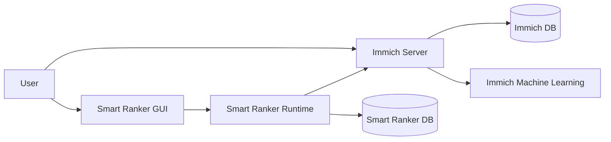
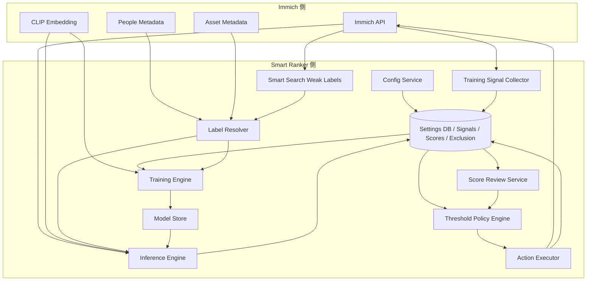
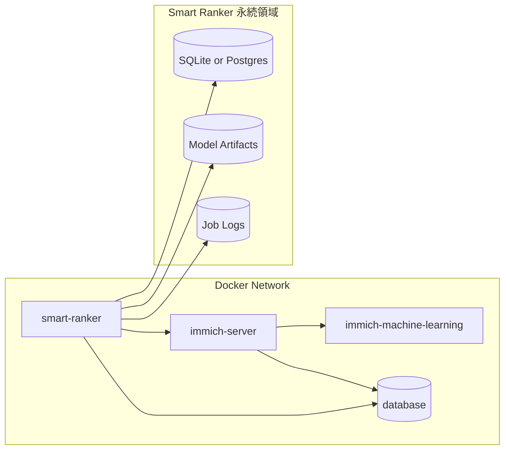
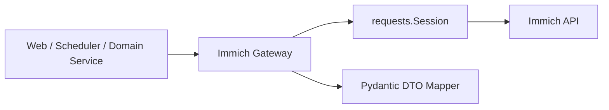
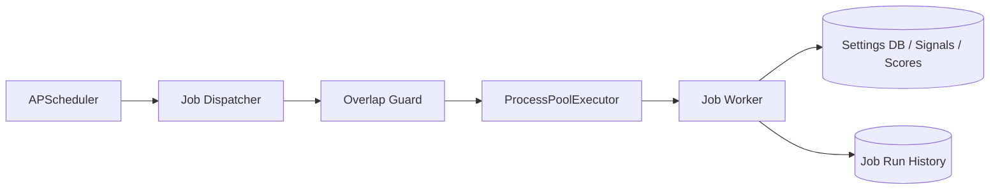

# Smart Ranker システム設計

## 目的

- Smart Ranker のシステム構成、実行基盤、保存方式、外部インターフェースを整理する。
- [設計書.md](./設計書.md) を要件・仕様の親文書とし、本書はそれを実装へ落とすための技術文書とする。
- `learn`、`score`、`apply` の責務分離と、GUI が扱う最新 score snapshot の流れを明確にする。

## 対象範囲

- Smart Ranker の v2 システム構成
- Immich との接続方式
- 学習、推論、自動処理の実行フロー
- 補助ストレージと設定 DB の責務
- 採用する主要技術スタック

## 設計方針

- Immich 本体のデータを主系とし、Smart Ranker 側は設定、手動学習 signal、score snapshot、auto trash 除外台帳、ジョブ履歴を保持する。
- `collect` と `train` は分けず、手動 favorite / manual trash の同期とモデル更新を `learn` でまとめて行う。
- `score` は asset 全件を対象にし、最新 completed run を GUI の唯一の表示基準にする。
- `apply` は GUI で保持する閾値を使って trash を実行し、そこで trash に入れた asset を future `learn` から除外する。
- GUI から変更しうる設定は DB に寄せる。
- 画像と動画を同一パイプラインで扱うが、動画スコアは Immich の preview image と通常メタデータに依存する近似値とみなす。

## システムコンテキスト

## 論理アーキテクチャ

## コンポーネント責務

| コンポーネント | 主責務 | 主な入出力 |
| --- | --- | --- |
| `Training Signal Collector` | current favorite と current trash の同期。解除、restore の終了記録。auto trash 除外の参照。 | 入力: Immich asset 状態、出力: `favorite_signal`, `trash_signal`, `sync_cursor` |
| `Config Service` | GUI 設定の読書き。人物グループ、カテゴリ、閾値、保護ルールの管理。 | 入力: GUI 更新、出力: 設定 DB |
| `Label Resolver` | People、通常メタデータ、smart search の弱ラベル、ルーティングルールから候補ラベル集合を生成。 | 入力: asset、設定 DB、弱ラベル候補、出力: ラベル集合 |
| `Training Engine` | 手動 signal を教師信号へ再構成し、ラベル別モデルと汎用モデルを学習。 | 入力: asset、embedding、`favorite_signal`, `trash_signal`、出力: 学習済みモデル |
| `Inference Engine` | asset 全件の score 算出と run 単位の snapshot 保存。 | 入力: asset、embedding、モデル、出力: `score_run`, `score_result` |
| `Score Review Service` | GUI 向けに score 順一覧を返し、最新 run を基準に閾値変更の影響を見せる。 | 入力: `score_result`、閾値設定、出力: 一覧 API |
| `Threshold Policy Engine` | 閾値、保護ルール、現在状態から trash 対象を選定する。 | 入力: score、設定 DB、出力: 実行計画 |
| `Action Executor` | Immich API への trash 実行、実行結果記録、auto trash 除外登録。 | 入力: 実行計画、出力: `action_execution_log`, `apply_exclusion_asset` |
| `Model Store` | 学習済みモデルとメタ情報の保存。 | 入力: 学習結果、出力: モデル読出し |

## データストアの役割分担

## Immich 側

- アセット本体
- `isFavorite`, `isTrashed`, `visibility`
- People メタデータ
- CLIP embedding
- `search/smart` の検索結果
- favorite、manual trash、restore などのユーザー操作結果

## Smart Ranker 側

- 設定 DB
- favorite signal と trash signal の長期保持
- GUI 変更可能な運用設定
- score snapshot と閾値設定
- `apply` 由来 asset の除外台帳
- 学習済みモデルのメタデータ
- ジョブ実行履歴と trash 実行ログ

## Smart Ranker DB に置く項目

- 人物グループ
- カテゴリ定義
- カテゴリ振り分けルール
- `search/smart` クエリ設定
- 削除閾値
- 保護ルール
- `favorite_signal`
- `trash_signal`
- `apply_exclusion_asset`
- `score_run` と `score_result`
- 実行スケジュールとジョブ履歴

詳細な論理スキーマは [db.md](./db.md) を参照。

## 配備構成

## 実行形態

| 項目 | v2 方針 |
| --- | --- |
| 実行単位 | 単一コンテナ。FastAPI と build 済み frontend asset を同梱 |
| API サーバ | FastAPI + Uvicorn |
| GUI | 別 frontend パッケージ。Svelte + TypeScript + Vite+ |
| GUI 配信 | 開発時は Vite dev server。本番は build 済み asset を FastAPI から配信 |
| スケジューラ | APScheduler の `BackgroundScheduler` |
| 長時間ジョブ実行 | `ProcessPoolExecutor` による別プロセス実行 |
| 補助 DB | SQLite を第一候補。必要なら Postgres へ移行 |
| モデル保存 | ローカル volume 上のファイル保存 |
| デプロイ形態 | Immich と同一 Docker network 内で常駐 |

## 実装モジュール構成

| モジュール | 採用技術 | 役割 |
| --- | --- | --- |
| `web` | FastAPI, Uvicorn | JSON API、build 済み frontend asset 配信、ヘルスチェック |
| `frontend` | Svelte, TypeScript, Vite+, kiso.css | 管理画面、score review UI、閾値操作 |
| `immich_client` | `requests.Session`, Pydantic DTO | Immich API 呼び出し、レスポンス正規化 |
| `immich_db_reader` | Postgres クライアント | CLIP embedding を read-only 取得 |
| `scheduler` | APScheduler | 定期ジョブ登録、手動実行の受付 |
| `job_runner` | `ProcessPoolExecutor` | `learn` と `score` の長時間ジョブ実行 |
| `domain` | 純粋 Python モジュール | signal 同期、ラベル解決、学習、推論、閾値評価 |
| `storage` | SQLAlchemy 2.0, Alembic | 設定 DB、signal 台帳、score snapshot、実行履歴の永続化 |
| `model_store` | `pickle`, `json` | 学習済みモデルとスナップショット保存 |

## API クライアント層

### レイヤ分割

| レイヤ | 主責務 | 主な操作 |
| --- | --- | --- |
| `ImmichSession` | `base_url`、認証ヘッダ、timeout、retry の統一 | GET / POST / PUT / DELETE の共通実行 |
| `AssetReadClient` | asset 一覧、favorite 一覧、trash 一覧、People 付き snapshot の取得 | asset metadata、search metadata 系 |
| `PeopleClient` | Person 解決とキャッシュ更新 | people list、person search 系 |
| `ActionWriteClient` | trash / restore 反映 | asset delete / restore 系 |
| `CapabilityRegistry` | Immich バージョン差分の吸収 | 起動時 capability check |
| `DtoNormalizer` | Immich 応答の内部 DTO 化 | `AssetSnapshot`, `PersonSnapshot`, `ActionResult` |

### 実装ルール

1. Immich への HTTP アクセスは、すべて `immich_client` を経由する。
1. CLIP embedding は `immich_db_reader` から read-only 接続で取得し、Immich DB への書き込みは行わない。
1. ドメイン層は Immich の生 JSON を直接扱わず、正規化済み DTO のみ扱う。
1. 読み取り系 API は retry 対象とする。
1. 書き込み系 API は自動 retry を既定で無効にし、呼び出し元で冪等性を担保する。
1. timestamp、visibility、people 配列の正規化は DTO 層で吸収する。
1. Immich の API 変更は `CapabilityRegistry` と `DtoNormalizer` で局所化する。

## ジョブ scheduler 設計

### 採用方針

- 定期実行は APScheduler で統一する。
- スケジュール定義の既定値はアプリ側に持ち、GUI 変更値は DB の `execution_schedule` で上書きする。
- `learn` と `score` は Web リクエストスレッドから分離し、`ProcessPoolExecutor` へ投入する。
- `apply` は最新 score snapshot を読む軽量 job とし、同一 `score_run` に対する多重適用を防ぐ。
- 同一 job 種別の同時実行は `max_instances=1` とアプリ内 overlap guard で禁止する。
- 手動実行も scheduler を経由し、定期実行と同じランナーを使う。

### v2 の標準ジョブ

| `job_type` | 既定トリガ | 実行方式 | 役割 |
| --- | --- | --- | --- |
| `learn_model` | 6 時間ごと | `ProcessPoolExecutor` | current favorite / current trash の同期、手動 signal 再構成、モデル学習 |
| `sync_people_catalog` | 30 分ごと | 軽量同期実行 | Person 一覧同期と名前解決 |
| `score_all_assets` | 6 時間ごと | `ProcessPoolExecutor` | asset 全件の score snapshot 生成 |
| `apply_trash_threshold` | 既定無効。手動実行 | 軽量同期実行 | 最新 threshold に基づく trash 実行と除外台帳更新 |
| `cleanup_runtime_state` | 毎日 04:00 | 軽量同期実行 | 古い score snapshot、不要な run 履歴の整理 |

### 実行制御

1. scheduler は起動時に `execution_schedule` を読み込む。
1. 無効化された job は登録しない。
1. 手動実行は GUI から発火し、scheduler の one-shot job として登録する。
1. 実行結果は成功、失敗、スキップを履歴へ残す。
1. `apply_trash_threshold` は対象 `score_run` と threshold 値を履歴へ固定して実行する。

## GUI 構成

### 採用方針

- GUI は Python backend と分離した frontend パッケージとして実装する。
- frontend の package manager は pnpm に固定する。
- frontend の build / dev / check / test は Vite+ の流れに寄せる。
- 画面実装は Svelte + TypeScript を使う。
- base style は kiso.css を先に読み込み、その上に project 固有 style を重ねる。
- 開発時は Vite dev server から配信し、FastAPI へ proxy する。
- 本番は build 済み asset を FastAPI から配信する。

### 画面構成

| 画面 | 主目的 | 主な操作 |
| --- | --- | --- |
| `Dashboard` | 実行状態の把握 | 最新 job 結果、モデルバージョン、score 件数確認 |
| `Person Groups` | 「家族」「我が子」設定 | Person 検索、グループ追加、順序変更 |
| `Categories & Routing` | ラベル定義と振り分け条件管理 | カテゴリ有効化、ルーティングルール編集 |
| `Score Review` | 全件 score の確認 | スコア順一覧、状態フィルタ、閾値変更、対象件数確認 |
| `Policies` | 閾値と保護設定 | 削除閾値、保護条件、apply 実行可否の調整 |
| `Jobs & Models` | 運用制御 | `learn`、`score`、`apply` の手動実行 |
| `Event Ledger` | 監査とデバッグ | signal 状態、auto trash 除外、job 履歴確認 |

### ルーティング構成

| 区分 | 代表パス | 用途 |
| --- | --- | --- |
| GUI entry | `/gui`, `/gui/*` | フロントエンド entry と client-side routing |
| Static assets | `/assets/*` | Vite build asset 配信 |
| JSON API | `/api/*` | GUI からの設定変更、実行操作 |
| 運用系 endpoint | `/healthz`, `/readyz` | ヘルスチェック |

### 画面から操作する設定

- Person Group
- Category
- Routing Rule
- Protected Rule
- Deletion Threshold
- Execution Schedule

### GUI の実装境界

1. GUI は設定の登録、変更、実行指示のみを行う。
1. 学習、推論、反映の本体ロジックは `domain` と `job_runner` に置く。
1. GUI は `storage` と `domain` を直接呼ばず、`/api/*` と FastAPI の service 層を経由する。
1. 一覧のソート、検索、ページングは API 側で処理する。

## 開発基盤

- frontend を含むため、開発環境は devcontainer を前提とする。
- runtime、補助 CLI、日常 task の正本は `mise.toml` に寄せる。
- frontend の依存管理は pnpm に固定する。
- `pnpm-workspace.yaml` を置き、supply chain 設定を初期値として入れる。
- 日常コマンドは `mise run` から呼び、frontend 側は `dev`、`check`、`test`、`build` の Vite+ 流儀へ寄せる。

### pnpm の初期セキュリティ設定

| 設定 | 値 | 目的 |
| --- | --- | --- |
| `minimumReleaseAge` | `10080` | 公開直後 package の取り込み抑止 |
| `strictDepBuilds` | `true` | 未承認 lifecycle script の遮断 |
| `blockExoticSubdeps` | `true` | git / tarball 依存の混入防止 |
| `trustPolicy` | `no-downgrade` | 配布経路の信頼性低下検知 |
| `onlyBuiltDependencies` | `[]` から開始 | build script 実行 package の明示許可 |

## 技術スタック

| 領域 | 採用技術 | 用途 |
| --- | --- | --- |
| Web / API | FastAPI, Uvicorn | 制御 API、静的 asset 配信、ヘルスチェック |
| Frontend | Svelte, TypeScript | 管理画面 |
| Frontend build | pnpm, Vite+ | frontend の dev、check、test、build |
| CSS baseline | kiso.css | reset と基礎スタイル |
| 開発基盤 | devcontainer, mise | tools、env、tasks の統一 |
| Node package security | pnpm-workspace.yaml | supply chain 設定の管理 |
| 言語 | Python 3.10+ | バッチ、学習、推論、API 呼び出し |
| DTO / 検証 | Pydantic v2 | Immich 応答の内部 DTO 化、設定検証 |
| 学習 | scikit-learn | Logistic Regression |
| 数値処理 | numpy, pandas | ベクトル処理、特徴量整形 |
| HTTP 通信 | requests | Immich API 呼び出し |
| Embedding 取得 | Postgres クライアント | Immich DB の read-only 参照 |
| ORM / Migration | SQLAlchemy 2.0, Alembic | 設定 DB、signal 台帳、score 履歴管理 |
| 補助 DB | SQLite / Postgres | 設定、signal 台帳、score 履歴、job 履歴 |
| モデル保存 | pickle, JSON | モデル本体、設定スナップショット |
| 実行基盤 | Docker | Immich と同一ネットワーク配置 |
| スケジューリング | APScheduler | 定期学習、全件 score、手動 apply |
| ジョブ並列化 | concurrent.futures.ProcessPoolExecutor | 長時間学習、推論の分離 |
| 図表 | Mermaid | アーキテクチャ図 |

## 主要ランタイムフロー

### `learn`

1. Immich API から current favorite と current trash を取得する。
1. `apply_exclusion_asset` を参照し、auto trash 済み asset を trash 側収集から除外する。
1. `favorite_signal` と `trash_signal` を upsert し、状態解除時は終了時刻だけを更新する。
1. `Label Resolver` が People、OCR、ファイルメタデータ、smart search の弱ラベルからカテゴリ候補を決定する。
1. 手動 signal の直近状態から教師信号を再構成する。
1. 汎用モデルとカテゴリ別モデルを学習し、モデルと設定 snapshot を保存する。

### `score`

1. asset 全件を取得する。
1. 汎用モデルとカテゴリ別モデルからラベル別スコアを算出する。
1. 最新 run を `score_run` と `score_result` に保存する。
1. GUI はこの run をスコア順に表示し、状態別フィルタと閾値変更を提供する。

### `apply`

1. GUI で保持している threshold と最新 completed `score_run` を読む。
1. 閾値以下、未保護、未 trash の asset を抽出する。
1. `Action Executor` が Immich API へ trash を反映する。
1. 成功した asset を `apply_exclusion_asset` に登録し、future `learn` から除外する。

## ラベルルーティングの実装方針

- ラベルは排他的にしない。
- 1 asset に複数ラベルを付与可能とする。
- 人物系のみ、学習と推論で有効モデルを 1 つに絞る。
- 書類、スクリーンショットは OCR、ファイル名、パス、タグなどの機械的ルールを優先する。
- 風景、ペットは `search/smart` の結果を弱ラベルとして扱う。
- 非人物系は該当する専用モデルを併用する。
- 汎用モデルは常時併用する。

## 主要設定の保持方針

### DB 保持対象

- 家族、我が子の Person ID 集合
- ラベル定義と表示名
- ルーティング条件
- `search/smart` クエリ語
- 削除閾値
- 保護ルール
- 実行スケジュール
- `favorite_signal`
- `trash_signal`
- `apply_exclusion_asset`
- `score_run` と `score_result`

### ファイル保持対象

- 学習済みモデル本体
- モデル保存時の設定スナップショット
- ローカル job log

## Immich 依存 API

| 用途 | API / データ |
| --- | --- |
| asset 一覧と状態取得 | asset metadata 系 API |
| current favorite の取得 | metadata search 系 API |
| current trash の取得 | metadata search 系 API |
| People 解決 | `/people` または検索系 API |
| 非人物系弱ラベル候補 | `search/smart` |
| CLIP embedding 取得 | Immich DB read-only の `smart_search` |
| trash 反映 | asset delete / trash 系 API |
| restore 反映 | asset restore 系 API |

具体的なエンドポイント名は Immich バージョン差分の影響を受けるため、実装では API クライアント層に隠蔽する。

## 動画対応の扱い

- 動画も学習、推論、自動処理の対象とする。
- ただし embedding と People 判定は Immich が生成した preview image に依存する。
- 動画全体の時間的内容や音声情報は v2 でも使わない。
- 画像と動画で threshold を分ける必要が出た場合は `media_scope` 別設定へ拡張する。

## 障害点と運用上の注意

- Immich 側の trash を無効化すると manual negative の運用前提が崩れる。
- `score_all_assets` は asset 全件を読むため、asset 数が増えると実行時間が伸びる。
- `apply_exclusion_asset` を解除しない限り、auto trash 済み asset は `learn` の negative として戻らない。
- Person 未命名や顔未検出の asset では「家族」「我が子」は付与できない。
- 動画スコアは代表フレーム依存のため、人物やイベント検出に偏りが出る可能性がある。
- `search/smart` の結果は Immich 側のモデルやクエリ語に依存するため、弱ラベルとしてのみ扱う。
- Immich API のフィールド仕様変更に備え、Collector 層はバージョン差分吸収層として実装する。

## v2 の非対象

- 動画全編解析
- 音声解析
- リアルタイム推論
- 分散学習
- Immich 本体 DB への直接書き込み

## 文書間の位置づけ

- 要件・仕様: [設計書.md](./設計書.md)
- 設定 DB の論理スキーマ: [db.md](./db.md)
- 本書: システム構成、責務分割、保存方式、技術スタック
